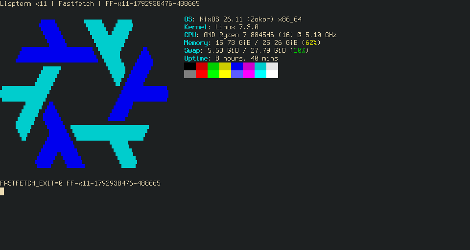
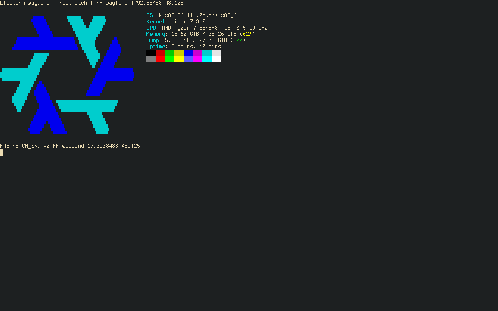

#+title: Real Fastfetch on Lispterm

* Reproduce
Run from the repository root, with Fastfetch, Xvfb/ImageMagick/xdotool,
Sway/grim/wtype, the packaged SBCL dependencies, and Terminus available:

#+begin_src sh
tests/fastfetch-gate.sh x11
tests/fastfetch-gate.sh wayland
#+end_src

The gates start a fresh Lispterm host with explicit backend selection and SBCL
stdin from =/dev/null=. The only terminal frontend is Lispterm. Fastfetch runs
on the host's real PTY; its wrapper inherits tty fd0/1/2 and supplies tty stdin
explicitly to Fastfetch. The dedicated test process observes actual =pty-read=
return bytes before the host feeds the engine. It does not synthesize output
or alter production source. A per-run nonce and =FASTFETCH_EXIT=0= must occur
in both the received transcript and the engine grid; Kernel and Memory must
also occur in the grid. Both Fastfetch and its wrapper must exit zero.

Fastfetch command:
#+begin_src sh
fastfetch --config none --logo nixos --pipe false \
  --structure OS:Kernel:CPU:Memory:Swap:Uptime:Colors
#+end_src

These modules omit usernames, hostnames, addresses, disks and network details.

* Captures verified 2026-10-25
Both PNGs were inspected visually: legible colored NixOS logo, OS/kernel/CPU,
memory/swap/uptime metrics, backend header, nonce, and successful exit footer.
They are unmodified native captures, not old captures or framebuffer exports.

- : Xvfb =:110=, actual window =2097153= captured with
  ImageMagick =import -window=. Explicit =:x11= backend, no Wayland display.
  Host received 2608 bytes, rendered one coalesced frame, reported zero errors.
- : own headless Sway with =xwayland disable=;
  =DISPLAY= absent, =WAYLAND_DISPLAY=wayland-1=. Explicit =:wayland= backend.
  =grim= captured the actual compositor output. Host received 2620 bytes,
  rendered two frames, reported zero errors. Sway configured a 50x160 grid.

Fastfetch version: =fastfetch 2.70.0 (x86_64)=.
Binary: =/nix/store/kpfr6xp51rrq41xdra708a9ywlwxk10n-fastfetch-2.70.0/bin/fastfetch=.
Binary SHA-256: =a94139bdab731bcef46fccb949077ffc0eb73ffc88ae65c1ce94865d0db652ca=.

| Backend | Nonce | Wrapper PID | Fastfetch PID | Exit |
|---------+-------+-------------+---------------+------|
| X11 | FF-x11-1792938476-488665 | 488719 | 488725 | 0 |
| Wayland | FF-wayland-1792938483-489125 | 489189 | 489196 | 0 |

Both wrappers recorded fd0/1/2 on =/dev/pts/28=, 32x120 at launch.
The captures ran sequentially, so reuse of the PTY number is expected.

* SHA-256 provenance
| Artifact | X11 |
|----------+-----|
| transcript.raw | e001399f29e4703bab3d5bf4504527fff8616804ea0b0746055c5322da744dd7 |
| grid.txt | 24026406ee0e5ca76b5add2ac08cc30ac986bbe570bd0e084bc60b6bbe170f32 |
| fastfetch-x11.png | 6c15af80f8aa0972bed978c576d987352df0ccad6c05a07ff0d4bdfbd46abcbe |

| Artifact | Wayland |
|----------+---------|
| transcript.raw | ae5a10a5b3d65dff58edb9cd04d0c3a34e3912cc027d1fd82a7b7ad9ee4fca63 |
| grid.txt | 3ee9836a9eafbc655d52fa15ad8cc6e37fbce688fa08f22e9e6ad290dcbda0a9 |
| fastfetch-wayland.png | 265b1be09c46e5ce66d2a41642a9d1da696a0fe9d4aa8c701cddfd7d382c9824 |

Original full captures, raw transcript, grid dump, process metadata, executable
hash, host snapshots, and display logs are retained locally in ignored
=.git/fastfetch-x11.mwDHWj/= and =.git/fastfetch-wayland.nbQ6Ka/=.
The latter also contains the actual Sway tree/output JSON and compositor config.
Each fresh gate writes its artifact directory to =.git/fastfetch-BACKEND-latest=;
the evidence above identifies these specific verified captures.
